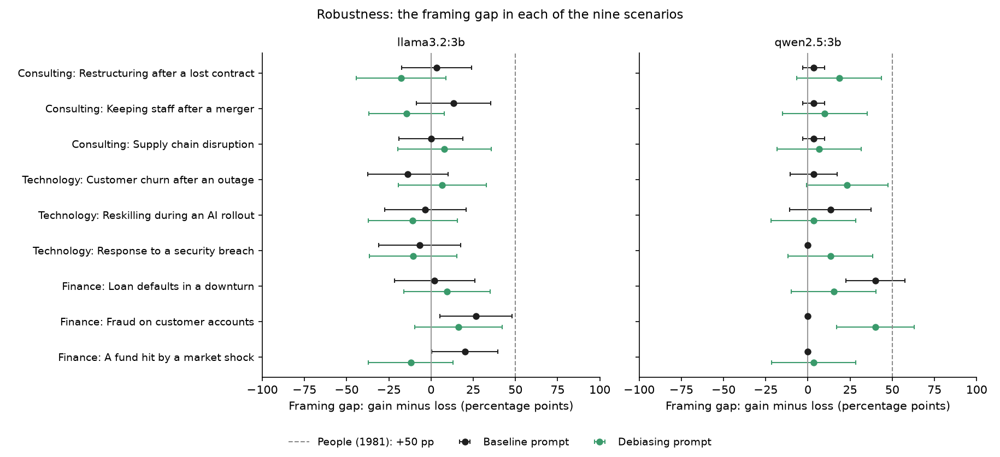

# Do large language models show human cognitive biases in business decisions, and can prompting reduce them?

**Status: complete (framing effect, two open-source models, November 2026).**

## Summary
I tested whether two small open-source language models are swayed by the framing effect, the classic human bias where the same choice gets different answers depending on whether outcomes are described as gains or losses. I used nine business scenarios across consulting, technology and finance, with 2,160 trials in total.

- **The models showed little of the human framing effect.** People in the original study showed a 50-point difference between gain and loss wording. The models showed 5 points (Llama, not significant) and 7 points (Qwen, significant but small).
- **A "think it through" prompt did not reduce the effect.** My second hypothesis was not supported.
- **Unexpectedly, when asked to reason first, both models were swayed far more by option order than by their wording.** Qwen chose the safe option 79% of the time when it was listed first and 24% when it was listed second; for Llama the figures were 66% and 10%. A regression controlling for wording and scenario confirmed this for both models.

My hypotheses were written and committed before any experiment was run: see [docs/hypotheses.md](docs/hypotheses.md).

## Question
Large language models are increasingly used to support business decisions. People make predictable errors in judgement, such as being swayed by how a choice is framed (Tversky and Kahneman, 1981). This project tests whether language models show the same framing effect in consulting, technology, and finance scenarios, and whether adding a debiasing instruction to the prompt reduces it.

## Why it matters
If the wording or layout of a question changes an AI system's recommendation even when the facts are identical, then people relying on AI advice inherit a bias they may not notice. Knowing when that happens, and whether simple prompting fixes it, helps organisations decide where AI judgement can be trusted and where a human needs to stay in the loop.

## Related work
Earlier studies have tested language models on classic decision-making problems. Jones and Steinhardt (2022) found framing effects in GPT-3 using a version of the original problem. Suri et al. (2023) found that GPT-3.5 shows several human-like decision heuristics, and suggested that part of the framing effect may come from patterns in language itself. Malberg et al. (2024) tested 30 cognitive biases across 20 models and found evidence of every bias in at least some models. Payne (2025) found that framing effects in models depend on context, with military scenarios producing larger effects than civilian ones.

This project adds three things: business scenarios across three sectors, so the effect can be compared across contexts; small open-source models that anyone can run for free on a laptop; and a pre-registered test of a simple debiasing prompt.

## Method
**Scenarios.** Nine business versions of the classic framing problem, three per sector:

| Sector | Scenarios |
|---|---|
| Consulting | Restructuring after a lost contract; keeping staff after a merger; supply chain disruption |
| Technology | Customer churn after an outage; reskilling during an AI rollout; response to a security breach |
| Finance | Loan defaults in a downturn; fraud on customer accounts; a fund hit by a market shock |

In each, 600 units are at risk and the two options have the same expected outcome:
- Certain option: 200 saved for sure (loss wording: 400 lost for sure).
- Risky option: a 1/3 chance all 600 are saved and a 2/3 chance none are (loss wording: a 1/3 chance none are lost and a 2/3 chance all 600 are lost).

Every scenario uses the same numbers and sentence structure, so only the business context changes. The scenarios were written fresh for this project, so a model can't simply recognise the original problem. The exact wording is in [src/scenarios.py](src/scenarios.py).

**Conditions.** A 2 x 2 design within each scenario:
- **Frame:** gain wording ("saved") or loss wording ("lost").
- **Prompt:** baseline (just choose) or debiasing (first describe both options in terms of what is saved *and* what is lost, then choose).

**Runs.** 30 runs per cell (9 scenarios x 2 frames x 2 prompts x 30 = 1,080 per model). Within each cell, the certain option appears first in half the runs and second in the other half, and all trials run in a shuffled order, so option position and timing can't explain a framing difference.

**Models.** Two small open-source models from different developers, run locally through [Ollama](https://ollama.com) (version 0.40.16): Llama 3.2 3B (`llama3.2:3b`, Meta) and Qwen 2.5 3B (`qwen2.5:3b`, Alibaba), at temperature 0.8, run on 18 November 2026.

**Recording answers.** Each reply had to end with "Answer: 1" or "Answer: 2". Replies without a readable answer were kept in the raw data, counted, and left out of the analysis, a rule fixed before running.

**Analysis.** For each scenario, a two-proportion z-test compares the share of certain choices in the gain and loss frames (H1). For H2, I compare the size of that gap with and without the debiasing prompt, with a bootstrap 95% confidence interval for the reduction. I also report the result pooled across all nine scenarios, how many scenarios show a significant effect, and a comparison with the original human result. Sector differences and option position are exploratory: the position effect is tested with the same z-test, and a logistic regression (with scenario fixed effects) estimates the effects of wording and position together. Code: [src/analyse.py](src/analyse.py).

**Pilot.** A pilot of 4 runs per cell was used to check the prompts; it is not part of the results. After it, I raised the reply length limit for the debiasing prompt and added the option-position check. Both changes are recorded in [docs/hypotheses.md](docs/hypotheses.md) before the full run.

## Results

### Headline: all nine scenarios pooled
Share of runs choosing the certain option. The gap is gain minus loss, in percentage points (pp). A positive gap is the human pattern.

| Who | Prompt | Gain wording | Loss wording | Gap (pp) | 95% interval | p |
|---|---|---|---|---|---|---|
| People (Tversky & Kahneman, 1981) | n/a | 72% | 22% | +50 | | |
| Llama 3.2 3B | baseline | 29% | 25% | +5 | -3 to +12 | 0.216 |
| Llama 3.2 3B | debiasing | 37% | 39% | -3 | -12 to +6 | 0.526 |
| Qwen 2.5 3B | baseline | 11% | 4% | +7 | +3 to +12 | 0.001 |
| Qwen 2.5 3B | debiasing | 59% | 44% | +15 | +7 to +23 | <0.001 |

### H1: framing effect
**Largely not supported.** Neither model showed the framing effect at anything close to human strength. Llama's pooled gap of 5 points was not significant. Qwen's gap of 7 points was significant but small, and came mostly from one scenario (loan defaults). Across the nine scenarios, only one per model showed a significant effect in the human direction, which is about what chance alone would produce.

### H2: debiasing prompt
**Not supported.** The debiasing prompt did not reduce the gap for either model.

| Model | Baseline gap (pp) | Debiasing gap (pp) | Reduction (pp) | 95% interval |
|---|---|---|---|---|
| Llama 3.2 3B | +5 | -3 | +8 | -3 to +19 |
| Qwen 2.5 3B | +7 | +15 | -7 | -17 to +2 |

For Qwen the gap grew, although the interval for the change includes zero. The debiasing prompt also made Qwen choose the safe option much more often overall (around 50%, up from under 11%). 

### Exploratory: with the reasoning prompt, order mattered far more than wording
The clearest pattern was one I did not predict. When asked to reason before answering, both models chose whichever option was listed first about three quarters of the time.

| Model | Prompt | Safe option chosen when listed first | Safe option chosen when listed second | Position effect (pp) | 95% interval | p |
|---|---|---|---|---|---|---|
| Llama 3.2 3B | baseline | 35% (94/267) | 19% (51/268) | +16 | +9 to +24 | <0.001 |
| Llama 3.2 3B | debiasing | 66% (157/238) | 10% (24/238) | +56 | +49 to +63 | <0.001 |
| Qwen 2.5 3B | baseline | 11% (30/270) | 4% (12/270) | +7 | +2 to +11 | 0.004 |
| Qwen 2.5 3B | debiasing | 79% (211/268) | 24% (66/270) | +54 | +47 to +61 | <0.001 |

With the debiasing prompt, moving the safe option from first to second place changed the choice by more than 50 points for both models, far more than any framing gap (15 points at most). Because position was balanced in every cell, this does not bias the framing results, but it shows how much these models' answers depend on layout. I first noticed this in the pilot and confirmed it in the full run, using fresh data.

**Wording and position in one model.** To compare the two effects directly, I fitted a logistic regression for each model and prompt. It predicts whether the safe option was chosen from the wording (gain or loss) and the position (first or second), while accounting for differences between scenarios. The numbers are odds ratios: 1 means no effect, and 5 means the odds of choosing the safe option were five times higher.

| Model | Prompt | Wording: gain vs loss | 95% CI | Position: first vs second | 95% CI |
|---|---|---|---|---|---|
| Llama 3.2 3B | baseline | 1.30 (p = 0.194) | 0.88 to 1.92 | 2.37 (p < 0.001) | 1.59 to 3.54 |
| Llama 3.2 3B | debiasing | 0.88 (p = 0.571) | 0.55 to 1.39 | 18.84 (p < 0.001) | 11.26 to 31.52 |
| Qwen 2.5 3B | baseline | 4.42 (p < 0.001) | 1.94 to 10.08 | 3.81 (p = 0.001) | 1.69 to 8.56 |
| Qwen 2.5 3B | debiasing | 2.38 (p < 0.001) | 1.56 to 3.64 | 13.17 (p < 0.001) | 8.58 to 20.22 |

With the debiasing prompt, being listed first multiplied the odds of the safe option being chosen by 19 (Llama) and 13 (Qwen), against at most 2.4 for wording. With the baseline prompt, both effects were small. For Qwen they were similar in size, and its large-looking odds ratios mainly reflect how rarely it chose the safe option at all (odds ratios grow quickly near zero). Three Qwen baseline scenarios where every answer was the same were left out of its regression, as they carry no information.

### Exploratory: Qwen prefers the gamble
With the baseline prompt, Qwen chose the risky option 89 to 96% of the time, whatever the wording. People tend to do the opposite when outcomes are described as gains.

Full tables, including every scenario and sector: [results/summary_table.md](results/summary_table.md). Raw replies: [results/](results/).

## What this means
For these small models, the framing bias that worries people about human decision-makers was weak. When the models were asked to reason first, though, their answers depended even more on which option was listed first. For anyone using AI to support decisions, it may be worth checking whether a recommendation changes when the options are swapped. Instructions to "think it through" shouldn't be assumed to make answers more reliable.

## Limitations
- **Small models.** Both models have about 3 billion parameters. Larger models, such as those used in commercial products, may behave differently.
- **Unreadable replies.** 64 of Llama's 540 debiasing replies (12%) did not give a readable answer and were left out, as planned. If those replies differ systematically, the debiasing results for Llama could be affected.
- **One temperature setting.** Results may change at other settings.
- **Training data.** The framing problem is famous. Rewording reduces, but can't rule out, the chance that models learned the "expected" answer.
- **A model is not a person.** A model "choosing" an option is a pattern in its text output, not a preference in the human sense. The comparison with human results is an analogy.
- **Multiple tests.** Nine scenarios are tested per model and prompt, so about one in twenty could reach p < 0.05 by chance. The pooled result and the consistency count matter more than any single p-value.
- **One structure.** All nine scenarios share the same numbers (600 at risk, 200 saved). Different stakes or probabilities might give different results.
- **The position finding is exploratory.** It was not a pre-registered hypothesis.
- **Odds ratios near zero.** When a model almost never chooses an option (as Qwen did in the baseline), odds ratios can look large even when the difference in percentage points is small, so I report both.

## Next steps
- **Larger and commercial models**, to see whether the framing and order effects shrink with model size.
- **Order effects directly:** test whether the order effect holds for other kinds of business decisions, and whether simple fixes such as asking the question twice in both orders remove it.
- **People and AI together.** The bigger question is what happens when a person makes the decision with an AI's advice: does an order-sensitive recommendation change the person's choice? That would connect this project to my MSc research on keeping humans in the loop.

## How to run
1. Install [Ollama](https://ollama.com) and download the models: `ollama pull llama3.2:3b` and `ollama pull qwen2.5:3b`
2. `pip install -r requirements.txt`
3. Check the setup: `python src/test_ollama.py llama3.2:3b`
4. Pilot: `python src/run_experiment.py --model llama3.2:3b --pilot`, then `python src/analyse.py --pilot`
5. Full runs: `python src/run_experiment.py --model llama3.2:3b` and `python src/run_experiment.py --model qwen2.5:3b`
6. Analysis: `python src/analyse.py`

Everything runs locally and costs nothing.

## References
- Jones, E., & Steinhardt, J. (2022). [Capturing failures of large language models via human cognitive biases](https://arxiv.org/abs/2202.12299). NeurIPS.
- Malberg, S., Poletukhin, R., Schuster, C. M., & Groh, G. (2024). [A comprehensive evaluation of cognitive biases in LLMs](https://arxiv.org/abs/2410.15413). arXiv.
- Payne, K. (2025). [An analysis of AI decision under risk: Prospect theory emerges in large language models](https://arxiv.org/abs/2508.00902). arXiv.
- Suri, G., et al. (2023). [Do large language models show decision heuristics similar to humans? A case study using GPT-3.5](https://arxiv.org/abs/2305.04400). arXiv.
- Tversky, A., & Kahneman, D. (1981). The framing of decisions and the psychology of choice. *Science*, 211(4481), 453-458.

## Declaration of AI use
Developed with assistance from Claude (Anthropic). Research question, hypotheses, and checking of results are my own.
