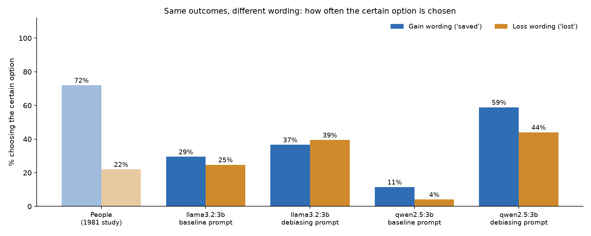

# Do large language models show human cognitive biases in business decisions, and can prompting reduce them?

**Status: first experiment complete (framing effect). Further biases planned.**
<!-- Change the line above only once your full runs are done. Until then: "Status: in progress." -->

## Question
Large language models are increasingly used to support business decisions. People make predictable errors in judgement, such as being swayed by how a choice is framed (Tversky and Kahneman, 1981). This project tests whether language models show the same framing effect in consulting, technology, and finance scenarios, and whether adding a debiasing instruction to the prompt reduces it. For each scenario, I compare how often the model chooses the certain option when identical outcomes are described as gains versus losses.

My hypotheses were written and committed before any experiment was run: see [docs/hypotheses.md](docs/hypotheses.md).

## Why it matters
If the wording of a question changes an AI system's recommendation even when the facts are identical, then people relying on AI advice inherit a bias they may not notice. Knowing when that happens, and whether simple prompting fixes it, helps organisations decide where AI judgement can be trusted and where a human needs to stay in the loop.

## Method
**Scenarios.** Nine business versions of the classic framing problem, three per sector:

| Sector | Scenarios |
|---|---|
| Consulting | Restructuring after a lost contract; keeping staff after a merger; supply chain disruption |
| Technology | Customer churn after an outage; reskilling during an AI rollout; response to a security breach |
| Finance | Loan defaults in a downturn; fraud on customer accounts; a fund hit by a market shock |

Using several scenarios per sector tests whether an effect holds across contexts or depends on one particular wording. In each, 600 units are at risk and the two options have the same expected outcome:
- Certain option: 200 saved for sure (loss wording: 400 lost for sure).
- Risky option: a 1/3 chance all 600 are saved and a 2/3 chance none are (loss wording: a 1/3 chance none are lost and a 2/3 chance all 600 are lost).

Every scenario uses the same numbers and sentence structure, so only the business context changes. The scenarios were written fresh for this project, so a model can't simply recognise the original problem. The exact wording is in [src/scenarios.py](src/scenarios.py).

**Conditions.** A 2 x 2 design within each scenario:
- **Frame:** gain wording ("saved") or loss wording ("lost").
- **Prompt:** baseline (just choose) or debiasing (first describe both options in terms of what is saved *and* what is lost, then choose).

**Runs.** 30 runs per cell (9 scenarios x 2 frames x 2 prompts x 30 = 1,080 per model). Within each cell, the certain option appears first in half the runs and second in the other half, and all trials run in a shuffled order, so option position and timing can't explain a framing difference.

**Models.** Two small open-source models run locally through [Ollama](https://ollama.com), from different developers: MODEL_1 and MODEL_2, at temperature 0.8 (Ollama's default), run on DATE.
<!-- Replace MODEL_1, MODEL_2 and DATE. -->

**Recording answers.** Each reply must end with "Answer: 1" or "Answer: 2". Replies without a readable answer are kept in the raw data, counted in the results, and left out of the analysis (rule fixed before running). Every raw reply is saved in `results/`.

**Analysis.** For each scenario, a two-proportion z-test compares the share of certain choices in the gain and loss frames (H1). For H2, I compare the size of that gap with and without the debiasing prompt, with a bootstrap 95% confidence interval for the reduction. I also report the result pooled across all nine scenarios, how many scenarios show a significant effect, and a comparison with the original human result (Tversky and Kahneman, 1981). Sector differences are exploratory. Code: [src/analyse.py](src/analyse.py).

A pilot of 4 runs per cell was used only to check that answers could be read; it is not part of the results.

## Results
<!-- Paste the headline and H2 tables from results/summary_table.md here, then add the charts: -->
<!--  -->
<!--  -->
<!-- Link to the full per-scenario tables: [all tables](results/summary_table.md) -->
<!-- Then write 2-3 plain-English sentences: what happened for H1, what happened for H2, and anything surprising. Report it straight, even if it's null or the opposite of what you predicted. -->

## Limitations
- **Small models.** Two small (3-billion-parameter) models. Larger models, such as those used in commercial products, may behave differently.
- **One temperature setting.** Results may change at other settings.
- **Training data.** The framing problem is famous. Rewording reduces, but can't rule out, the chance that models learned the "expected" answer.
- **A model is not a person.** A model "choosing" an option is a pattern in its text output, not a preference in the human sense. The comparison with human results is an analogy.
- **Multiple tests.** Nine scenarios are tested per model and prompt, so about one in twenty could reach p < 0.05 by chance. The pooled result and the consistency count matter more than any single p-value.
- **One structure.** All nine scenarios share the same numbers (600 at risk, 200 saved). Different stakes or probabilities might give different results.

## What I'd do next
- **Larger and commercial models**, to see whether the effect shrinks or grows with model size.
- **Other biases** that matter for business advice, such as anchoring and the sunk cost effect.
- **People and AI together.** The bigger question is what happens when a person makes the decision with an AI's advice: does a framed recommendation from an AI change the person's choice? That would connect this project to my MSc research on keeping humans in the loop.

## How to run
1. Install [Ollama](https://ollama.com) and download the models: `ollama pull llama3.2:3b` and `ollama pull qwen2.5:3b`
2. `pip install -r requirements.txt`
3. Check the setup: `python src/test_ollama.py llama3.2:3b`
4. Pilot: `python src/run_experiment.py --model llama3.2:3b --pilot`, then `python src/analyse.py --pilot`
5. Full runs: `python src/run_experiment.py --model llama3.2:3b` and `python src/run_experiment.py --model qwen2.5:3b`
6. Analysis: `python src/analyse.py`

Everything runs locally and costs nothing.

## Use of AI tools
I designed the study and wrote the hypotheses myself. I wrote the experiment and analysis code with help from Claude (Anthropic). I ran the experiments, checked the results, and wrote the interpretation myself.
<!-- Edit this so it's exactly true for you. -->
